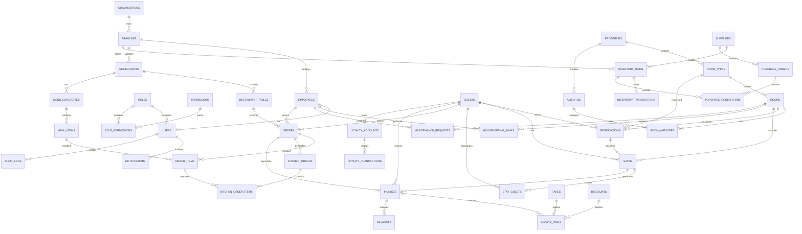

# HOTEL & RESTAURANT MANAGEMENT SYSTEM

## DATABASE ERD + COMPLETE TABLE DEFINITIONS

**Project:** Hotel & Restaurant Management System (HRMS)  
**Document:** Database Design Specification  
**Version:** 1.0  
**Database:** PostgreSQL  
**Backend:** Java + Spring Boot  
**Frontend:** Next.js + TypeScript  
**Status:** Implementation-Ready Database Blueprint  
**Date:** September 2026

---

# TABLE OF CONTENTS

1. Database Design Overview
2. Database Design Principles
3. Naming Conventions
4. Entity Relationship Overview
5. Complete ERD
6. Authentication & Authorization
7. Organization & Branches
8. Employee Management
9. Guest & Customer Management
10. Hotel Management
11. Reservation Management
12. Stay Management
13. Housekeeping
14. Maintenance
15. Restaurant Management
16. Menu Management
17. Restaurant Tables
18. Order Management
19. Kitchen Management
20. Billing & Invoices
21. Payments
22. Taxes & Discounts
23. Inventory
24. Suppliers
25. Procurement
26. Loyalty Management
27. Notifications
28. Audit Logging
29. System Configuration
30. Complete Table Definitions
31. Relationships
32. Indexing Strategy
33. Data Integrity Rules
34. Soft Delete Strategy
35. Audit Fields
36. Database Security
37. Transaction Requirements
38. Backup Requirements
39. Migration Strategy
40. Seed Data
41. Final Database Structure

---

# 1. DATABASE DESIGN OVERVIEW

The database will use a relational architecture based on PostgreSQL.

The system will be divided into logical domains:

```text
AUTHENTICATION
ORGANIZATION
EMPLOYEES
GUESTS
HOTEL
RESERVATIONS
STAYS
HOUSEKEEPING
MAINTENANCE
RESTAURANT
MENU
ORDERS
KITCHEN
BILLING
PAYMENTS
INVENTORY
SUPPLIERS
PROCUREMENT
LOYALTY
NOTIFICATIONS
AUDIT
SYSTEM CONFIGURATION
```

---

# 2. DATABASE DESIGN PRINCIPLES

The database shall follow:

- Relational database principles
- Normalization
- Referential integrity
- ACID transactions
- Foreign-key enforcement
- Unique constraints
- Check constraints
- Appropriate indexing
- Auditability
- Secure data handling
- Scalable table design

The initial design targets approximately **45 core tables**, with additional tables available for future expansion.

---

# 3. NAMING CONVENTIONS

## 3.1 Tables

Use lowercase `snake_case`.

Example:

```text
users
employees
room_types
reservations
order_items
purchase_orders
```

## 3.2 Columns

Use lowercase `snake_case`.

Example:

```text
first_name
last_name
created_at
updated_at
room_type_id
```

## 3.3 Primary Keys

All primary keys shall use:

```sql
UUID
```

Example:

```sql
id UUID PRIMARY KEY
```

UUIDs provide globally unique identifiers and simplify distributed deployments.

---

# 4. STANDARD AUDIT COLUMNS

Most transactional tables should include:

```sql
created_at TIMESTAMPTZ NOT NULL DEFAULT CURRENT_TIMESTAMP,
updated_at TIMESTAMPTZ NOT NULL DEFAULT CURRENT_TIMESTAMP
```

Where appropriate:

```sql
created_by UUID,
updated_by UUID,
deleted_at TIMESTAMPTZ
```

---

# 5. COMPLETE ENTITY RELATIONSHIP DIAGRAM

The following Mermaid ERD represents the major database relationships.



---

# 6. AUTHENTICATION & AUTHORIZATION

The security model consists of:

```text
USERS
  │
  └── ROLES
       │
       └── ROLE_PERMISSIONS
             │
             └── PERMISSIONS
```

---

# 7. TABLE: organizations

Stores the primary business organization.

```sql
CREATE TABLE organizations (
    id UUID PRIMARY KEY DEFAULT gen_random_uuid(),

    name VARCHAR(150) NOT NULL,
    legal_name VARCHAR(200),

    registration_number VARCHAR(100),
    tax_number VARCHAR(100),

    phone VARCHAR(30),
    email VARCHAR(150),
    website VARCHAR(255),

    address_line_1 VARCHAR(200),
    address_line_2 VARCHAR(200),
    city VARCHAR(100),
    county VARCHAR(100),
    country VARCHAR(100) NOT NULL DEFAULT 'Kenya',

    currency_code CHAR(3) NOT NULL DEFAULT 'KES',

    logo_url TEXT,

    status VARCHAR(20) NOT NULL DEFAULT 'ACTIVE',

    created_at TIMESTAMPTZ NOT NULL DEFAULT CURRENT_TIMESTAMP,
    updated_at TIMESTAMPTZ NOT NULL DEFAULT CURRENT_TIMESTAMP
);
```

---

# 8. TABLE: branches

Supports multiple hotel/restaurant branches.

```sql
CREATE TABLE branches (
    id UUID PRIMARY KEY DEFAULT gen_random_uuid(),

    organization_id UUID NOT NULL
        REFERENCES organizations(id),

    name VARCHAR(150) NOT NULL,

    code VARCHAR(50) NOT NULL,

    phone VARCHAR(30),
    email VARCHAR(150),

    address_line_1 VARCHAR(200),
    address_line_2 VARCHAR(200),
    city VARCHAR(100),
    county VARCHAR(100),
    country VARCHAR(100) DEFAULT 'Kenya',

    timezone VARCHAR(50) DEFAULT 'Africa/Nairobi',

    status VARCHAR(20) NOT NULL DEFAULT 'ACTIVE',

    created_at TIMESTAMPTZ NOT NULL DEFAULT CURRENT_TIMESTAMP,
    updated_at TIMESTAMPTZ NOT NULL DEFAULT CURRENT_TIMESTAMP,

    UNIQUE (organization_id, code)
);
```

---

# 9. TABLE: roles

```sql
CREATE TABLE roles (
    id UUID PRIMARY KEY DEFAULT gen_random_uuid(),

    name VARCHAR(100) NOT NULL UNIQUE,

    description TEXT,

    is_system_role BOOLEAN NOT NULL DEFAULT FALSE,

    created_at TIMESTAMPTZ NOT NULL DEFAULT CURRENT_TIMESTAMP,
    updated_at TIMESTAMPTZ NOT NULL DEFAULT CURRENT_TIMESTAMP
);
```

Example roles:

```text
SUPER_ADMIN
GENERAL_MANAGER
HOTEL_MANAGER
RECEPTIONIST
HOUSEKEEPER
RESTAURANT_MANAGER
WAITER
CHEF
CASHIER
STOREKEEPER
PROCUREMENT_OFFICER
ACCOUNTANT
```

---

# 10. TABLE: permissions

```sql
CREATE TABLE permissions (
    id UUID PRIMARY KEY DEFAULT gen_random_uuid(),

    code VARCHAR(100) NOT NULL UNIQUE,

    name VARCHAR(150) NOT NULL,

    description TEXT,

    module VARCHAR(100),

    created_at TIMESTAMPTZ NOT NULL DEFAULT CURRENT_TIMESTAMP
);
```

Examples:

```text
ROOM_VIEW
ROOM_CREATE
ROOM_UPDATE
ROOM_DELETE

RESERVATION_VIEW
RESERVATION_CREATE
RESERVATION_UPDATE
RESERVATION_CANCEL

PAYMENT_VIEW
PAYMENT_CREATE
PAYMENT_REFUND
```

---

# 11. TABLE: role_permissions

```sql
CREATE TABLE role_permissions (
    role_id UUID NOT NULL
        REFERENCES roles(id)
        ON DELETE CASCADE,

    permission_id UUID NOT NULL
        REFERENCES permissions(id)
        ON DELETE CASCADE,

    PRIMARY KEY (role_id, permission_id)
);
```

---

# 12. TABLE: employees

```sql
CREATE TABLE employees (
    id UUID PRIMARY KEY DEFAULT gen_random_uuid(),

    branch_id UUID
        REFERENCES branches(id),

    employee_number VARCHAR(50) NOT NULL,

    first_name VARCHAR(100) NOT NULL,
    middle_name VARCHAR(100),
    last_name VARCHAR(100) NOT NULL,

    phone VARCHAR(30),
    email VARCHAR(150),

    department VARCHAR(100),
    position VARCHAR(100),

    employment_status VARCHAR(30) DEFAULT 'ACTIVE',

    date_joined DATE,

    created_at TIMESTAMPTZ NOT NULL DEFAULT CURRENT_TIMESTAMP,
    updated_at TIMESTAMPTZ NOT NULL DEFAULT CURRENT_TIMESTAMP,

    UNIQUE (employee_number)
);
```

---

# 13. TABLE: users

```sql
CREATE TABLE users (
    id UUID PRIMARY KEY DEFAULT gen_random_uuid(),

    employee_id UUID UNIQUE
        REFERENCES employees(id),

    role_id UUID NOT NULL
        REFERENCES roles(id),

    username VARCHAR(100) NOT NULL UNIQUE,

    email VARCHAR(150) UNIQUE,

    password_hash TEXT NOT NULL,

    account_status VARCHAR(30) NOT NULL DEFAULT 'ACTIVE',

    last_login_at TIMESTAMPTZ,

    failed_login_attempts INTEGER NOT NULL DEFAULT 0,

    locked_until TIMESTAMPTZ,

    created_at TIMESTAMPTZ NOT NULL DEFAULT CURRENT_TIMESTAMP,
    updated_at TIMESTAMPTZ NOT NULL DEFAULT CURRENT_TIMESTAMP
);
```

---

# 14. TABLE: guests

Stores hotel guests and restaurant customers.

```sql
CREATE TABLE guests (
    id UUID PRIMARY KEY DEFAULT gen_random_uuid(),

    property_id UUID NOT NULL
        REFERENCES properties(id) ON DELETE RESTRICT,

    guest_number VARCHAR(50) NOT NULL,

    first_name VARCHAR(100) NOT NULL,
    middle_name VARCHAR(100),
    last_name VARCHAR(100) NOT NULL,

    phone VARCHAR(30),
    email VARCHAR(150),

    nationality VARCHAR(100),

    identification_type VARCHAR(50),
    identification_number VARCHAR(100),

    address_line_1 VARCHAR(200),
    address_line_2 VARCHAR(200),
    city VARCHAR(100),
    county VARCHAR(100),
    country VARCHAR(100),

    date_of_birth DATE,

    emergency_contact_name VARCHAR(150),
    emergency_contact_phone VARCHAR(30),

    notes TEXT,

    created_at TIMESTAMPTZ NOT NULL DEFAULT CURRENT_TIMESTAMP,
    updated_at TIMESTAMPTZ NOT NULL DEFAULT CURRENT_TIMESTAMP,

    UNIQUE (property_id, guest_number),
    CHECK (
        (identification_type IS NULL AND identification_number IS NULL)
        OR (identification_type IS NOT NULL AND identification_number IS NOT NULL)
    )
);
```

---

Guest numbers and identification numbers are unique within a property. The implementation uses a case-insensitive partial unique index for identification numbers, allowing the same guest to have a separate profile at another property.

# 15. HOTEL STRUCTURE

The hotel hierarchy is:

```text
BRANCH
   │
   └── ROOM TYPES
          │
          └── ROOMS
                 │
                 ├── AMENITIES
                 ├── RESERVATIONS
                 ├── STAYS
                 ├── HOUSEKEEPING
                 └── MAINTENANCE
```

---

# 16. TABLE: room_types

```sql
CREATE TABLE room_types (
    id UUID PRIMARY KEY DEFAULT gen_random_uuid(),

    property_id UUID NOT NULL
        REFERENCES properties(id) ON DELETE RESTRICT,

    name VARCHAR(100) NOT NULL,

    code VARCHAR(50) NOT NULL,

    description TEXT,

    base_price NUMERIC(12,2) NOT NULL DEFAULT 0,

    max_occupancy INTEGER NOT NULL DEFAULT 1,

    size_square_meters NUMERIC(8,2),

    status VARCHAR(30) NOT NULL DEFAULT 'ACTIVE',

    created_at TIMESTAMPTZ NOT NULL DEFAULT CURRENT_TIMESTAMP,
    updated_at TIMESTAMPTZ NOT NULL DEFAULT CURRENT_TIMESTAMP,

    CHECK (code = UPPER(code)),
    CHECK (base_price >= 0),
    CHECK (max_occupancy > 0),
    CHECK (size_square_meters IS NULL OR size_square_meters > 0),
    CHECK (status IN ('ACTIVE', 'INACTIVE'))
);
```

Room types are property-owned. Their code is unique without regard to letter case within a property. The API normalizes codes to uppercase.

```sql
CREATE INDEX idx_room_types_property_id ON room_types(property_id);
CREATE UNIQUE INDEX uq_room_types_property_code_ci
    ON room_types(property_id, lower(code));
```

---

# 17. TABLE: rooms

```sql
CREATE TABLE rooms (
    id UUID PRIMARY KEY DEFAULT gen_random_uuid(),

    branch_id UUID NOT NULL
        REFERENCES branches(id),

    room_type_id UUID NOT NULL
        REFERENCES room_types(id),

    room_number VARCHAR(30) NOT NULL,

    floor_number INTEGER,

    capacity INTEGER NOT NULL DEFAULT 1,

    current_status VARCHAR(30) NOT NULL DEFAULT 'AVAILABLE',

    description TEXT,

    created_at TIMESTAMPTZ NOT NULL DEFAULT CURRENT_TIMESTAMP,
    updated_at TIMESTAMPTZ NOT NULL DEFAULT CURRENT_TIMESTAMP,

    UNIQUE (branch_id, room_number)
);
```

Room statuses:

```text
AVAILABLE
RESERVED
OCCUPIED
DIRTY
CLEANING
MAINTENANCE
OUT_OF_ORDER
```

---

# 18. TABLE: amenities

```sql
CREATE TABLE amenities (
    id UUID PRIMARY KEY DEFAULT gen_random_uuid(),

    property_id UUID NOT NULL
        REFERENCES properties(id) ON DELETE RESTRICT,

    name VARCHAR(100) NOT NULL,

    description TEXT,

    created_at TIMESTAMPTZ NOT NULL DEFAULT CURRENT_TIMESTAMP,
    updated_at TIMESTAMPTZ NOT NULL DEFAULT CURRENT_TIMESTAMP,

);

CREATE INDEX idx_amenities_property_id ON amenities(property_id);
CREATE UNIQUE INDEX uq_amenities_property_name_ci
    ON amenities(property_id, lower(name));
```

Amenity names are unique without regard to letter case within a property. The migration uses a PostgreSQL functional unique index for this rule.

---

# 19. TABLE: room_amenities

```sql
CREATE TABLE room_amenities (
    room_id UUID NOT NULL
        REFERENCES rooms(id)
        ON DELETE CASCADE,

    amenity_id UUID NOT NULL
        REFERENCES amenities(id)
        ON DELETE CASCADE,

    PRIMARY KEY (room_id, amenity_id)
);
```

---

# 20. RESERVATIONS

# TABLE: reservations

```sql
CREATE TABLE reservations (
    id UUID PRIMARY KEY DEFAULT gen_random_uuid(),

    reservation_number VARCHAR(50) NOT NULL UNIQUE,

    branch_id UUID NOT NULL
        REFERENCES branches(id),

    guest_id UUID NOT NULL
        REFERENCES guests(id),

    room_type_id UUID
        REFERENCES room_types(id),

    room_id UUID
        REFERENCES rooms(id),

    check_in_date DATE NOT NULL,

    check_out_date DATE NOT NULL,

    adults INTEGER NOT NULL DEFAULT 1,

    children INTEGER NOT NULL DEFAULT 0,

    number_of_rooms INTEGER NOT NULL DEFAULT 1,

    nightly_rate NUMERIC(12,2) NOT NULL,

    deposit_amount NUMERIC(12,2) NOT NULL DEFAULT 0,

    booking_source VARCHAR(50) DEFAULT 'DIRECT',

    special_requests TEXT,

    status VARCHAR(30) NOT NULL DEFAULT 'PENDING',

    cancelled_at TIMESTAMPTZ,

    cancellation_reason TEXT,

    created_by UUID
        REFERENCES users(id),

    created_at TIMESTAMPTZ NOT NULL DEFAULT CURRENT_TIMESTAMP,

    updated_at TIMESTAMPTZ NOT NULL DEFAULT CURRENT_TIMESTAMP,

    CHECK (check_out_date > check_in_date),

    CHECK (adults >= 1),

    CHECK (children >= 0),

    CHECK (nightly_rate >= 0)
);
```

Reservation statuses:

```text
PENDING
CONFIRMED
CHECKED_IN
COMPLETED
CANCELLED
NO_SHOW
```

---

# 21. STAYS

A reservation becomes an active stay during check-in.

## TABLE: stays

```sql
CREATE TABLE stays (
    id UUID PRIMARY KEY DEFAULT gen_random_uuid(),

    stay_number VARCHAR(50) NOT NULL UNIQUE,

    reservation_id UUID UNIQUE
        REFERENCES reservations(id),

    guest_id UUID NOT NULL
        REFERENCES guests(id),

    room_id UUID NOT NULL
        REFERENCES rooms(id),

    actual_check_in TIMESTAMPTZ NOT NULL,

    expected_check_out TIMESTAMPTZ NOT NULL,

    actual_check_out TIMESTAMPTZ,

    adults INTEGER NOT NULL DEFAULT 1,

    children INTEGER NOT NULL DEFAULT 0,

    status VARCHAR(30) NOT NULL DEFAULT 'ACTIVE',

    notes TEXT,

    checked_in_by UUID
        REFERENCES users(id),

    checked_out_by UUID
        REFERENCES users(id),

    created_at TIMESTAMPTZ NOT NULL DEFAULT CURRENT_TIMESTAMP,

    updated_at TIMESTAMPTZ NOT NULL DEFAULT CURRENT_TIMESTAMP
);
```

Stay statuses:

```text
ACTIVE
CHECKED_OUT
CANCELLED
```

---

# 22. TABLE: stay_guests

Allows multiple guests to belong to one stay.

```sql
CREATE TABLE stay_guests (
    stay_id UUID NOT NULL
        REFERENCES stays(id)
        ON DELETE CASCADE,

    guest_id UUID NOT NULL
        REFERENCES guests(id)
        ON DELETE CASCADE,

    is_primary_guest BOOLEAN NOT NULL DEFAULT FALSE,

    PRIMARY KEY (stay_id, guest_id)
);
```

---

# 23. HOUSEKEEPING

## TABLE: housekeeping_tasks

```sql
CREATE TABLE housekeeping_tasks (
    id UUID PRIMARY KEY DEFAULT gen_random_uuid(),

    room_id UUID NOT NULL
        REFERENCES rooms(id),

    assigned_to UUID
        REFERENCES employees(id),

    task_type VARCHAR(50) NOT NULL DEFAULT 'CLEANING',

    priority VARCHAR(30) DEFAULT 'NORMAL',

    status VARCHAR(30) NOT NULL DEFAULT 'PENDING',

    started_at TIMESTAMPTZ,

    completed_at TIMESTAMPTZ,

    notes TEXT,

    created_at TIMESTAMPTZ NOT NULL DEFAULT CURRENT_TIMESTAMP,

    updated_at TIMESTAMPTZ NOT NULL DEFAULT CURRENT_TIMESTAMP
);
```

---

# 24. MAINTENANCE

## TABLE: maintenance_requests

```sql
CREATE TABLE maintenance_requests (
    id UUID PRIMARY KEY DEFAULT gen_random_uuid(),

    room_id UUID
        REFERENCES rooms(id),

    reported_by UUID
        REFERENCES employees(id),

    assigned_to UUID
        REFERENCES employees(id),

    title VARCHAR(200) NOT NULL,

    description TEXT,

    priority VARCHAR(30) NOT NULL DEFAULT 'MEDIUM',

    status VARCHAR(30) NOT NULL DEFAULT 'OPEN',

    resolution TEXT,

    reported_at TIMESTAMPTZ NOT NULL DEFAULT CURRENT_TIMESTAMP,

    resolved_at TIMESTAMPTZ,

    created_at TIMESTAMPTZ NOT NULL DEFAULT CURRENT_TIMESTAMP,

    updated_at TIMESTAMPTZ NOT NULL DEFAULT CURRENT_TIMESTAMP
);
```

---

# 25. RESTAURANTS

## TABLE: restaurants

```sql
CREATE TABLE restaurants (
    id UUID PRIMARY KEY DEFAULT gen_random_uuid(),

    branch_id UUID NOT NULL
        REFERENCES branches(id),

    name VARCHAR(150) NOT NULL,

    description TEXT,

    phone VARCHAR(30),

    opening_time TIME,
    closing_time TIME,

    status VARCHAR(30) NOT NULL DEFAULT 'ACTIVE',

    created_at TIMESTAMPTZ NOT NULL DEFAULT CURRENT_TIMESTAMP,

    updated_at TIMESTAMPTZ NOT NULL DEFAULT CURRENT_TIMESTAMP
);
```

---

# 26. RESTAURANT TABLES

## TABLE: restaurant_tables

```sql
CREATE TABLE restaurant_tables (
    id UUID PRIMARY KEY DEFAULT gen_random_uuid(),

    restaurant_id UUID NOT NULL
        REFERENCES restaurants(id),

    table_number VARCHAR(30) NOT NULL,

    capacity INTEGER NOT NULL DEFAULT 2,

    location VARCHAR(100),

    status VARCHAR(30) NOT NULL DEFAULT 'AVAILABLE',

    created_at TIMESTAMPTZ NOT NULL DEFAULT CURRENT_TIMESTAMP,

    updated_at TIMESTAMPTZ NOT NULL DEFAULT CURRENT_TIMESTAMP,

    UNIQUE (restaurant_id, table_number)
);
```

---

# 27. MENU CATEGORIES

## TABLE: menu_categories

```sql
CREATE TABLE menu_categories (
    id UUID PRIMARY KEY DEFAULT gen_random_uuid(),

    restaurant_id UUID NOT NULL
        REFERENCES restaurants(id),

    name VARCHAR(100) NOT NULL,

    description TEXT,

    display_order INTEGER DEFAULT 0,

    status VARCHAR(30) DEFAULT 'ACTIVE',

    created_at TIMESTAMPTZ NOT NULL DEFAULT CURRENT_TIMESTAMP,

    updated_at TIMESTAMPTZ NOT NULL DEFAULT CURRENT_TIMESTAMP
);
```

---

# 28. MENU ITEMS

## TABLE: menu_items

```sql
CREATE TABLE menu_items (
    id UUID PRIMARY KEY DEFAULT gen_random_uuid(),

    category_id UUID NOT NULL
        REFERENCES menu_categories(id),

    name VARCHAR(150) NOT NULL,

    sku VARCHAR(50),

    description TEXT,

    selling_price NUMERIC(12,2) NOT NULL,

    image_url TEXT,

    preparation_time_minutes INTEGER,

    is_available BOOLEAN NOT NULL DEFAULT TRUE,

    created_at TIMESTAMPTZ NOT NULL DEFAULT CURRENT_TIMESTAMP,

    updated_at TIMESTAMPTZ NOT NULL DEFAULT CURRENT_TIMESTAMP,

    CHECK (selling_price >= 0)
);
```

---

# 29. ORDERS

## TABLE: orders

```sql
CREATE TABLE orders (
    id UUID PRIMARY KEY DEFAULT gen_random_uuid(),

    order_number VARCHAR(50) NOT NULL UNIQUE,

    restaurant_id UUID NOT NULL
        REFERENCES restaurants(id),

    table_id UUID
        REFERENCES restaurant_tables(id),

    guest_id UUID
        REFERENCES guests(id),

    stay_id UUID
        REFERENCES stays(id),

    waiter_id UUID
        REFERENCES employees(id),

    order_type VARCHAR(30) NOT NULL DEFAULT 'DINE_IN',

    status VARCHAR(30) NOT NULL DEFAULT 'NEW',

    subtotal NUMERIC(12,2) NOT NULL DEFAULT 0,

    tax_amount NUMERIC(12,2) NOT NULL DEFAULT 0,

    discount_amount NUMERIC(12,2) NOT NULL DEFAULT 0,

    total_amount NUMERIC(12,2) NOT NULL DEFAULT 0,

    notes TEXT,

    ordered_at TIMESTAMPTZ NOT NULL DEFAULT CURRENT_TIMESTAMP,

    completed_at TIMESTAMPTZ,

    created_at TIMESTAMPTZ NOT NULL DEFAULT CURRENT_TIMESTAMP,

    updated_at TIMESTAMPTZ NOT NULL DEFAULT CURRENT_TIMESTAMP
);
```

Order types:

```text
DINE_IN
TAKEAWAY
DELIVERY
ROOM_SERVICE
```

---

# 30. ORDER ITEMS

## TABLE: order_items

```sql
CREATE TABLE order_items (
    id UUID PRIMARY KEY DEFAULT gen_random_uuid(),

    order_id UUID NOT NULL
        REFERENCES orders(id)
        ON DELETE CASCADE,

    menu_item_id UUID NOT NULL
        REFERENCES menu_items(id),

    quantity INTEGER NOT NULL,

    unit_price NUMERIC(12,2) NOT NULL,

    discount_amount NUMERIC(12,2) NOT NULL DEFAULT 0,

    tax_amount NUMERIC(12,2) NOT NULL DEFAULT 0,

    subtotal NUMERIC(12,2) NOT NULL,

    special_instructions TEXT,

    status VARCHAR(30) NOT NULL DEFAULT 'PENDING',

    created_at TIMESTAMPTZ NOT NULL DEFAULT CURRENT_TIMESTAMP,

    CHECK (quantity > 0),

    CHECK (unit_price >= 0)
);
```

---

# 31. KITCHEN ORDERS

## TABLE: kitchen_orders

```sql
CREATE TABLE kitchen_orders (
    id UUID PRIMARY KEY DEFAULT gen_random_uuid(),

    order_id UUID NOT NULL
        REFERENCES orders(id)
        ON DELETE CASCADE,

    status VARCHAR(30) NOT NULL DEFAULT 'NEW',

    priority VARCHAR(30) DEFAULT 'NORMAL',

    accepted_by UUID
        REFERENCES employees(id),

    started_at TIMESTAMPTZ,

    ready_at TIMESTAMPTZ,

    completed_at TIMESTAMPTZ,

    created_at TIMESTAMPTZ NOT NULL DEFAULT CURRENT_TIMESTAMP,

    updated_at TIMESTAMPTZ NOT NULL DEFAULT CURRENT_TIMESTAMP
);
```

---

# 32. KITCHEN ORDER ITEMS

```sql
CREATE TABLE kitchen_order_items (
    kitchen_order_id UUID NOT NULL
        REFERENCES kitchen_orders(id)
        ON DELETE CASCADE,

    order_item_id UUID NOT NULL
        REFERENCES order_items(id)
        ON DELETE CASCADE,

    quantity INTEGER NOT NULL,

    status VARCHAR(30) NOT NULL DEFAULT 'NEW',

    PRIMARY KEY (kitchen_order_id, order_item_id)
);
```

---

# 33. TAXES

## TABLE: taxes

```sql
CREATE TABLE taxes (
    id UUID PRIMARY KEY DEFAULT gen_random_uuid(),

    organization_id UUID NOT NULL
        REFERENCES organizations(id),

    name VARCHAR(100) NOT NULL,

    code VARCHAR(50) NOT NULL,

    rate NUMERIC(7,4) NOT NULL,

    is_inclusive BOOLEAN NOT NULL DEFAULT FALSE,

    status VARCHAR(30) NOT NULL DEFAULT 'ACTIVE',

    created_at TIMESTAMPTZ NOT NULL DEFAULT CURRENT_TIMESTAMP,

    updated_at TIMESTAMPTZ NOT NULL DEFAULT CURRENT_TIMESTAMP,

    CHECK (rate >= 0)
);
```

---

# 34. DISCOUNTS

## TABLE: discounts

```sql
CREATE TABLE discounts (
    id UUID PRIMARY KEY DEFAULT gen_random_uuid(),

    organization_id UUID NOT NULL
        REFERENCES organizations(id),

    name VARCHAR(100) NOT NULL,

    discount_type VARCHAR(20) NOT NULL,

    value NUMERIC(12,2) NOT NULL,

    minimum_amount NUMERIC(12,2),

    maximum_discount NUMERIC(12,2),

    start_date DATE,

    end_date DATE,

    status VARCHAR(30) DEFAULT 'ACTIVE',

    created_at TIMESTAMPTZ NOT NULL DEFAULT CURRENT_TIMESTAMP,

    updated_at TIMESTAMPTZ NOT NULL DEFAULT CURRENT_TIMESTAMP
);
```

Discount types:

```text
PERCENTAGE
FIXED_AMOUNT
```

---

# 35. INVOICES

## TABLE: invoices

```sql
CREATE TABLE invoices (
    id UUID PRIMARY KEY DEFAULT gen_random_uuid(),

    invoice_number VARCHAR(50) NOT NULL UNIQUE,

    branch_id UUID NOT NULL
        REFERENCES branches(id),

    guest_id UUID
        REFERENCES guests(id),

    stay_id UUID
        REFERENCES stays(id),

    order_id UUID
        REFERENCES orders(id),

    invoice_date TIMESTAMPTZ NOT NULL DEFAULT CURRENT_TIMESTAMP,

    due_date DATE,

    subtotal NUMERIC(12,2) NOT NULL DEFAULT 0,

    tax_amount NUMERIC(12,2) NOT NULL DEFAULT 0,

    discount_amount NUMERIC(12,2) NOT NULL DEFAULT 0,

    total_amount NUMERIC(12,2) NOT NULL DEFAULT 0,

    amount_paid NUMERIC(12,2) NOT NULL DEFAULT 0,

    balance_due NUMERIC(12,2) NOT NULL DEFAULT 0,

    status VARCHAR(30) NOT NULL DEFAULT 'UNPAID',

    notes TEXT,

    created_at TIMESTAMPTZ NOT NULL DEFAULT CURRENT_TIMESTAMP,

    updated_at TIMESTAMPTZ NOT NULL DEFAULT CURRENT_TIMESTAMP
);
```

Invoice statuses:

```text
DRAFT
UNPAID
PARTIALLY_PAID
PAID
VOID
REFUNDED
```

---

# 36. INVOICE ITEMS

## TABLE: invoice_items

```sql
CREATE TABLE invoice_items (
    id UUID PRIMARY KEY DEFAULT gen_random_uuid(),

    invoice_id UUID NOT NULL
        REFERENCES invoices(id)
        ON DELETE CASCADE,

    description VARCHAR(255) NOT NULL,

    quantity NUMERIC(12,2) NOT NULL DEFAULT 1,

    unit_price NUMERIC(12,2) NOT NULL,

    subtotal NUMERIC(12,2) NOT NULL,

    tax_id UUID
        REFERENCES taxes(id),

    tax_amount NUMERIC(12,2) NOT NULL DEFAULT 0,

    discount_id UUID
        REFERENCES discounts(id),

    discount_amount NUMERIC(12,2) NOT NULL DEFAULT 0,

    total_amount NUMERIC(12,2) NOT NULL,

    reference_type VARCHAR(50),

    reference_id UUID
);
```

---

# 37. PAYMENTS

## TABLE: payments

```sql
CREATE TABLE payments (
    id UUID PRIMARY KEY DEFAULT gen_random_uuid(),

    payment_reference VARCHAR(100) NOT NULL UNIQUE,

    invoice_id UUID NOT NULL
        REFERENCES invoices(id),

    amount NUMERIC(12,2) NOT NULL,

    payment_method VARCHAR(50) NOT NULL,

    transaction_reference VARCHAR(150),

    currency_code CHAR(3) NOT NULL DEFAULT 'KES',

    status VARCHAR(30) NOT NULL DEFAULT 'PENDING',

    payment_provider VARCHAR(100),

    received_by UUID
        REFERENCES users(id),

    paid_at TIMESTAMPTZ,

    notes TEXT,

    created_at TIMESTAMPTZ NOT NULL DEFAULT CURRENT_TIMESTAMP,

    updated_at TIMESTAMPTZ NOT NULL DEFAULT CURRENT_TIMESTAMP,

    CHECK (amount > 0)
);
```

Payment methods:

```text
CASH
CARD
MOBILE_MONEY
BANK_TRANSFER
ONLINE
OTHER
```

---

# 38. INVENTORY

Inventory hierarchy:

```text
SUPPLIER
   │
   └── INVENTORY ITEMS
          │
          └── INVENTORY TRANSACTIONS
```

---

# 39. TABLE: inventory_categories

```sql
CREATE TABLE inventory_categories (
    id UUID PRIMARY KEY DEFAULT gen_random_uuid(),

    organization_id UUID NOT NULL
        REFERENCES organizations(id),

    name VARCHAR(100) NOT NULL,

    description TEXT,

    created_at TIMESTAMPTZ NOT NULL DEFAULT CURRENT_TIMESTAMP
);
```

---

# 40. TABLE: inventory_items

```sql
CREATE TABLE inventory_items (
    id UUID PRIMARY KEY DEFAULT gen_random_uuid(),

    branch_id UUID NOT NULL
        REFERENCES branches(id),

    category_id UUID
        REFERENCES inventory_categories(id),

    supplier_id UUID,

    sku VARCHAR(100) NOT NULL,

    name VARCHAR(150) NOT NULL,

    description TEXT,

    unit VARCHAR(50) NOT NULL,

    quantity NUMERIC(14,3) NOT NULL DEFAULT 0,

    reorder_level NUMERIC(14,3) NOT NULL DEFAULT 0,

    reorder_quantity NUMERIC(14,3),

    unit_cost NUMERIC(12,2) NOT NULL DEFAULT 0,

    status VARCHAR(30) NOT NULL DEFAULT 'ACTIVE',

    created_at TIMESTAMPTZ NOT NULL DEFAULT CURRENT_TIMESTAMP,

    updated_at TIMESTAMPTZ NOT NULL DEFAULT CURRENT_TIMESTAMP,

    UNIQUE (branch_id, sku),

    CHECK (quantity >= 0)
);
```

---

# 41. TABLE: inventory_transactions

```sql
CREATE TABLE inventory_transactions (
    id UUID PRIMARY KEY DEFAULT gen_random_uuid(),

    inventory_item_id UUID NOT NULL
        REFERENCES inventory_items(id),

    transaction_type VARCHAR(40) NOT NULL,

    quantity NUMERIC(14,3) NOT NULL,

    unit_cost NUMERIC(12,2),

    previous_quantity NUMERIC(14,3) NOT NULL,

    new_quantity NUMERIC(14,3) NOT NULL,

    reference_type VARCHAR(50),

    reference_id UUID,

    performed_by UUID
        REFERENCES users(id),

    notes TEXT,

    created_at TIMESTAMPTZ NOT NULL DEFAULT CURRENT_TIMESTAMP
);
```

Transaction types:

```text
PURCHASE
SALE
ISSUE
RETURN
WASTAGE
ADJUSTMENT
TRANSFER_IN
TRANSFER_OUT
```

---

# 42. SUPPLIERS

## TABLE: suppliers

```sql
CREATE TABLE suppliers (
    id UUID PRIMARY KEY DEFAULT gen_random_uuid(),

    organization_id UUID NOT NULL
        REFERENCES organizations(id),

    supplier_code VARCHAR(50) NOT NULL UNIQUE,

    company_name VARCHAR(200) NOT NULL,

    contact_person VARCHAR(150),

    phone VARCHAR(30),

    email VARCHAR(150),

    address_line_1 VARCHAR(200),
    address_line_2 VARCHAR(200),

    city VARCHAR(100),
    county VARCHAR(100),
    country VARCHAR(100),

    tax_number VARCHAR(100),

    payment_terms VARCHAR(100),

    status VARCHAR(30) NOT NULL DEFAULT 'ACTIVE',

    created_at TIMESTAMPTZ NOT NULL DEFAULT CURRENT_TIMESTAMP,

    updated_at TIMESTAMPTZ NOT NULL DEFAULT CURRENT_TIMESTAMP
);
```

---

# 43. PURCHASE ORDERS

## TABLE: purchase_orders

```sql
CREATE TABLE purchase_orders (
    id UUID PRIMARY KEY DEFAULT gen_random_uuid(),

    purchase_order_number VARCHAR(50) NOT NULL UNIQUE,

    branch_id UUID NOT NULL
        REFERENCES branches(id),

    supplier_id UUID NOT NULL
        REFERENCES suppliers(id),

    requested_by UUID
        REFERENCES users(id),

    approved_by UUID
        REFERENCES users(id),

    order_date DATE NOT NULL DEFAULT CURRENT_DATE,

    expected_delivery_date DATE,

    subtotal NUMERIC(12,2) NOT NULL DEFAULT 0,

    tax_amount NUMERIC(12,2) NOT NULL DEFAULT 0,

    total_amount NUMERIC(12,2) NOT NULL DEFAULT 0,

    status VARCHAR(30) NOT NULL DEFAULT 'DRAFT',

    notes TEXT,

    created_at TIMESTAMPTZ NOT NULL DEFAULT CURRENT_TIMESTAMP,

    updated_at TIMESTAMPTZ NOT NULL DEFAULT CURRENT_TIMESTAMP
);
```

---

# 44. PURCHASE ORDER ITEMS

```sql
CREATE TABLE purchase_order_items (
    id UUID PRIMARY KEY DEFAULT gen_random_uuid(),

    purchase_order_id UUID NOT NULL
        REFERENCES purchase_orders(id)
        ON DELETE CASCADE,

    inventory_item_id UUID NOT NULL
        REFERENCES inventory_items(id),

    quantity NUMERIC(14,3) NOT NULL,

    unit_cost NUMERIC(12,2) NOT NULL,

    received_quantity NUMERIC(14,3) NOT NULL DEFAULT 0,

    subtotal NUMERIC(12,2) NOT NULL,

    CHECK (quantity > 0)
);
```

---

# 45. LOYALTY ACCOUNTS

## TABLE: loyalty_accounts

```sql
CREATE TABLE loyalty_accounts (
    id UUID PRIMARY KEY DEFAULT gen_random_uuid(),

    guest_id UUID NOT NULL UNIQUE
        REFERENCES guests(id),

    membership_number VARCHAR(50) NOT NULL UNIQUE,

    tier VARCHAR(50) NOT NULL DEFAULT 'STANDARD',

    points_balance INTEGER NOT NULL DEFAULT 0,

    status VARCHAR(30) NOT NULL DEFAULT 'ACTIVE',

    created_at TIMESTAMPTZ NOT NULL DEFAULT CURRENT_TIMESTAMP,

    updated_at TIMESTAMPTZ NOT NULL DEFAULT CURRENT_TIMESTAMP,

    CHECK (points_balance >= 0)
);
```

---

# 46. LOYALTY TRANSACTIONS

## TABLE: loyalty_transactions

```sql
CREATE TABLE loyalty_transactions (
    id UUID PRIMARY KEY DEFAULT gen_random_uuid(),

    loyalty_account_id UUID NOT NULL
        REFERENCES loyalty_accounts(id),

    transaction_type VARCHAR(30) NOT NULL,

    points INTEGER NOT NULL,

    reference_type VARCHAR(50),

    reference_id UUID,

    description TEXT,

    created_at TIMESTAMPTZ NOT NULL DEFAULT CURRENT_TIMESTAMP
);
```

Transaction types:

```text
EARN
REDEEM
ADJUSTMENT
EXPIRE
```

---

# 47. NOTIFICATIONS

## TABLE: notifications

```sql
CREATE TABLE notifications (
    id UUID PRIMARY KEY DEFAULT gen_random_uuid(),

    user_id UUID
        REFERENCES users(id),

    guest_id UUID
        REFERENCES guests(id),

    title VARCHAR(200) NOT NULL,

    message TEXT NOT NULL,

    notification_type VARCHAR(50),

    channel VARCHAR(30) NOT NULL DEFAULT 'IN_APP',

    status VARCHAR(30) NOT NULL DEFAULT 'PENDING',

    sent_at TIMESTAMPTZ,

    read_at TIMESTAMPTZ,

    created_at TIMESTAMPTZ NOT NULL DEFAULT CURRENT_TIMESTAMP
);
```

---

# 48. AUDIT LOGS

## TABLE: audit_logs

```sql
CREATE TABLE audit_logs (
    id UUID PRIMARY KEY DEFAULT gen_random_uuid(),

    user_id UUID
        REFERENCES users(id),

    action VARCHAR(100) NOT NULL,

    entity_type VARCHAR(100),

    entity_id UUID,

    old_values JSONB,

    new_values JSONB,

    ip_address INET,

    user_agent TEXT,

    created_at TIMESTAMPTZ NOT NULL DEFAULT CURRENT_TIMESTAMP
);
```

Audit logs should generally be append-only.

---

# 49. SYSTEM SETTINGS

## TABLE: system_settings

```sql
CREATE TABLE system_settings (
    id UUID PRIMARY KEY DEFAULT gen_random_uuid(),

    organization_id UUID NOT NULL
        REFERENCES organizations(id),

    setting_key VARCHAR(150) NOT NULL,

    setting_value TEXT,

    data_type VARCHAR(30) DEFAULT 'STRING',

    description TEXT,

    updated_by UUID
        REFERENCES users(id),

    created_at TIMESTAMPTZ NOT NULL DEFAULT CURRENT_TIMESTAMP,

    updated_at TIMESTAMPTZ NOT NULL DEFAULT CURRENT_TIMESTAMP,

    UNIQUE (organization_id, setting_key)
);
```

Examples:

```text
CHECK_IN_TIME
CHECK_OUT_TIME
DEFAULT_CURRENCY
DEFAULT_TAX
RESERVATION_PREFIX
INVOICE_PREFIX
ORDER_PREFIX
LOW_STOCK_THRESHOLD
```

---

# 50. COMPLETE TABLE INVENTORY

The complete initial schema consists of:

```text
01. organizations
02. branches

03. roles
04. permissions
05. role_permissions
06. employees
07. users

08. guests

09. room_types
10. rooms
11. amenities
12. room_amenities

13. reservations
14. stays
15. stay_guests

16. housekeeping_tasks
17. maintenance_requests

18. restaurants
19. restaurant_tables
20. menu_categories
21. menu_items

22. orders
23. order_items
24. kitchen_orders
25. kitchen_order_items

26. taxes
27. discounts

28. invoices
29. invoice_items
30. payments

31. inventory_categories
32. inventory_items
33. inventory_transactions

34. suppliers
35. purchase_orders
36. purchase_order_items

37. loyalty_accounts
38. loyalty_transactions

39. notifications
40. audit_logs
41. system_settings
```

---

# 51. PRIMARY RELATIONSHIPS

## Organization

```text
organizations
    │
    └── branches
```

One organization can have many branches.

---

## Branch

```text
branches
    ├── employees
    ├── room_types
    ├── rooms
    ├── reservations
    ├── restaurants
    ├── inventory
    └── invoices
```

---

## Guest

```text
guests
    ├── reservations
    ├── stays
    ├── orders
    ├── invoices
    ├── loyalty_account
    └── notifications
```

---

## Reservation

```text
reservation
    ├── guest
    ├── room_type
    ├── room
    └── stay
```

---

## Stay

```text
stay
    ├── guest
    ├── room
    ├── reservation
    ├── stay_guests
    ├── orders
    └── invoices
```

---

## Restaurant

```text
restaurant
    ├── restaurant_tables
    └── menu_categories
             │
             └── menu_items
```

---

## Order

```text
order
    ├── table
    ├── guest
    ├── stay
    ├── waiter
    ├── order_items
    └── kitchen_order
```

---

## Invoice

```text
invoice
    ├── guest
    ├── stay
    ├── order
    ├── invoice_items
    └── payments
```

---

## Inventory

```text
inventory_item
    ├── category
    ├── supplier
    └── inventory_transactions
```

---

# 52. INDEXING STRATEGY

Indexes shall be created for frequently queried columns.

## Users

```sql
CREATE INDEX idx_users_role_id
ON users(role_id);

CREATE INDEX idx_users_status
ON users(account_status);
```

## Guests

```sql
CREATE INDEX idx_guests_name
ON guests(last_name, first_name);

CREATE INDEX idx_guests_phone
ON guests(phone);

CREATE INDEX idx_guests_email
ON guests(email);
```

## Reservations

```sql
CREATE INDEX idx_reservations_guest
ON reservations(guest_id);

CREATE INDEX idx_reservations_room
ON reservations(room_id);

CREATE INDEX idx_reservations_dates
ON reservations(check_in_date, check_out_date);

CREATE INDEX idx_reservations_status
ON reservations(status);
```

## Stays

```sql
CREATE INDEX idx_stays_guest
ON stays(guest_id);

CREATE INDEX idx_stays_room
ON stays(room_id);

CREATE INDEX idx_stays_status
ON stays(status);
```

## Orders

```sql
CREATE INDEX idx_orders_guest
ON orders(guest_id);

CREATE INDEX idx_orders_table
ON orders(table_id);

CREATE INDEX idx_orders_status
ON orders(status);

CREATE INDEX idx_orders_ordered_at
ON orders(ordered_at);
```

## Inventory

```sql
CREATE INDEX idx_inventory_branch
ON inventory_items(branch_id);

CREATE INDEX idx_inventory_sku
ON inventory_items(sku);

CREATE INDEX idx_inventory_quantity
ON inventory_items(quantity);
```

---

# 53. RESERVATION CONFLICT PROTECTION

PostgreSQL should prevent overlapping room reservations at the database level where possible.

For date-based room bookings, an exclusion constraint can be implemented using a PostgreSQL date range.

Example conceptual implementation:

```sql
EXCLUDE USING gist (
    room_id WITH =,
    daterange(check_in_date, check_out_date, '[)') WITH &&
)
WHERE (
    room_id IS NOT NULL
    AND status IN ('PENDING', 'CONFIRMED', 'CHECKED_IN')
);
```

This provides an additional database-level protection against double booking.

The application layer must still perform availability validation.

---

# 54. DATA INTEGRITY RULES

## Rule 1

A room must belong to a valid branch.

## Rule 2

A room must belong to a valid room type.

## Rule 3

A reservation must belong to a valid guest.

## Rule 4

Check-out date must be later than check-in date.

## Rule 5

Invoice amounts cannot be negative.

## Rule 6

Payment amounts must be positive.

## Rule 7

Inventory quantity cannot normally become negative.

## Rule 8

An order must contain at least one order item before completion.

## Rule 9

A purchase order must contain purchase items before approval.

## Rule 10

Deleted users must not automatically delete historical transactions.

---

# 55. SOFT DELETE STRATEGY

Financial and historical records should generally not be physically deleted.

Instead:

```text
deleted_at
```

may be used for appropriate master records.

Examples:

```text
Menu Items
Employees
Rooms
Suppliers
Guests
```

Transactions such as:

```text
Payments
Invoices
Audit Logs
Inventory Transactions
```

should generally remain permanently available according to applicable retention requirements.

---

# 56. AUDIT FIELDS

Critical tables should include:

```text
created_at
updated_at
created_by
updated_by
```

Examples:

```text
reservations
invoices
payments
purchase_orders
inventory_transactions
users
```

---

# 57. MONEY STORAGE

All financial values shall use:

```sql
NUMERIC(12,2)
```

or a larger precision where required.

Do not use floating-point types for financial amounts.

Example:

```sql
price NUMERIC(12,2)
```

---

# 58. TIME AND DATE STORAGE

Use:

```sql
DATE
```

for dates without time.

Use:

```sql
TIMESTAMPTZ
```

for events requiring time.

Examples:

```text
Check-in → TIMESTAMPTZ
Payment → TIMESTAMPTZ
Reservation date → DATE
Birth date → DATE
Invoice date → TIMESTAMPTZ
```

The default operational timezone shall be configurable, with Kenya initially using:

```text
Africa/Nairobi
```

---

# 59. DATABASE SECURITY

The application should connect using a dedicated database user.

Example conceptual roles:

```text
hrms_application
hrms_reporting
hrms_migration
```

The application database user should not have unnecessary administrative privileges.

Database credentials must never be hardcoded into source code.

Use environment variables or secure secret management.

---

# 60. TRANSACTION REQUIREMENTS

The following operations should be atomic.

## Check-In

```text
Create/activate stay
+
Assign room
+
Update room status
```

## Check-Out

```text
Calculate final charges
+
Record payment
+
Update invoice
+
Close stay
+
Update room status
```

## Purchase Receiving

```text
Receive purchase
+
Increase inventory
+
Create inventory transaction
```

## Restaurant Sale

```text
Create order
+
Create order items
+
Generate financial record
+
Update inventory where applicable
```

If a critical operation fails, the related database transaction should roll back.

---

# 61. INVENTORY TRANSACTION MODEL

Inventory should not rely solely on changing the current quantity.

The system should maintain both:

```text
inventory_items.quantity
```

and:

```text
inventory_transactions
```

Example:

```text
Opening Stock
      ↓
Purchase +20
      ↓
Issue -5
      ↓
Wastage -2
      ↓
Current Stock = 13
```

This makes stock movement auditable.

---

# 62. DATABASE MIGRATIONS

Database schema changes shall be managed through migration tools.

Recommended options:

```text
Flyway
```

or:

```text
Liquibase
```

For Spring Boot, Flyway is a straightforward option.

Example:

```text
V1__initial_schema.sql
V2__create_authentication_tables.sql
V3__create_hotel_tables.sql
V4__create_restaurant_tables.sql
V5__create_inventory_tables.sql
V6__create_finance_tables.sql
```

---

# 63. SEED DATA

Initial deployment should seed system data.

## Roles

```text
SUPER_ADMIN
GENERAL_MANAGER
HOTEL_MANAGER
RECEPTIONIST
HOUSEKEEPER
RESTAURANT_MANAGER
WAITER
CHEF
CASHIER
STOREKEEPER
PROCUREMENT_OFFICER
ACCOUNTANT
```

## Permissions

Permissions should be generated for each major operation.

## Room statuses

```text
AVAILABLE
RESERVED
OCCUPIED
DIRTY
CLEANING
MAINTENANCE
OUT_OF_ORDER
```

## Order statuses

```text
NEW
CONFIRMED
PREPARING
READY
SERVED
COMPLETED
CANCELLED
```

## Payment methods

```text
CASH
CARD
MOBILE_MONEY
BANK_TRANSFER
ONLINE
OTHER
```

---

# 64. FUTURE DATABASE TABLES

The architecture should leave room for future tables such as:

```text
room_rate_plans
seasonal_rates
booking_channels
online_bookings

food_recipes
recipe_ingredients

delivery_orders
delivery_addresses

employee_attendance
employee_shifts
payroll

expenses
financial_accounts
journal_entries

customer_feedback
complaints

promotions
coupons

hotel_services
service_charges

branches
properties

api_keys
webhooks

payment_transactions
refunds

file_attachments
```

These should be added through future migrations rather than overloading the initial schema.

---

# 65. DATABASE MODULE MAP

```text
DATABASE
│
├── AUTH
│   ├── users
│   ├── roles
│   ├── permissions
│   └── role_permissions
│
├── ORGANIZATION
│   ├── organizations
│   └── branches
│
├── STAFF
│   └── employees
│
├── CUSTOMERS
│   └── guests
│
├── HOTEL
│   ├── room_types
│   ├── rooms
│   ├── amenities
│   └── room_amenities
│
├── RESERVATIONS
│   ├── reservations
│   ├── stays
│   └── stay_guests
│
├── OPERATIONS
│   ├── housekeeping_tasks
│   └── maintenance_requests
│
├── RESTAURANT
│   ├── restaurants
│   ├── restaurant_tables
│   ├── menu_categories
│   └── menu_items
│
├── ORDERS
│   ├── orders
│   ├── order_items
│   ├── kitchen_orders
│   └── kitchen_order_items
│
├── FINANCE
│   ├── taxes
│   ├── discounts
│   ├── invoices
│   ├── invoice_items
│   └── payments
│
├── INVENTORY
│   ├── inventory_categories
│   ├── inventory_items
│   └── inventory_transactions
│
├── PROCUREMENT
│   ├── suppliers
│   ├── purchase_orders
│   └── purchase_order_items
│
├── LOYALTY
│   ├── loyalty_accounts
│   └── loyalty_transactions
│
└── SYSTEM
    ├── notifications
    ├── audit_logs
    └── system_settings
```

---

# 66. COMPLETE DATA FLOW

The primary hotel workflow is:

```text
GUEST
  ↓
RESERVATION
  ↓
ROOM
  ↓
CHECK-IN
  ↓
STAY
  ↓
ROOM SERVICE / RESTAURANT
  ↓
CHARGES
  ↓
INVOICE
  ↓
PAYMENT
  ↓
CHECK-OUT
  ↓
ROOM DIRTY
  ↓
HOUSEKEEPING
  ↓
ROOM AVAILABLE
```

The restaurant workflow is:

```text
CUSTOMER
  ↓
TABLE
  ↓
ORDER
  ↓
ORDER ITEMS
  ↓
KITCHEN
  ↓
PREPARATION
  ↓
READY
  ↓
SERVED
  ↓
INVOICE
  ↓
PAYMENT
```

The inventory workflow is:

```text
SUPPLIER
  ↓
PURCHASE ORDER
  ↓
GOODS RECEIVED
  ↓
INVENTORY
  ↓
STOCK ISSUE
  ↓
RESTAURANT / HOUSEKEEPING
  ↓
INVENTORY TRANSACTION
```

---

# 67. DATABASE PERFORMANCE GUIDELINES

The application shall:

- Use indexed foreign keys.
- Paginate large result sets.
- Avoid unnecessary `SELECT *`.
- Use database transactions appropriately.
- Avoid N+1 query problems.
- Use connection pooling.
- Use prepared statements.
- Use query optimization for reports.
- Archive historical data where appropriate.

Spring Boot should use a connection pool such as HikariCP.

---

# 68. REPORTING CONSIDERATIONS

Reports should query transactional tables without changing transactional records.

Potential future reporting architecture:

```text
POSTGRESQL
     │
     ▼
REPORTING QUERIES
     │
     ▼
AGGREGATED DATA
     │
     ▼
DASHBOARD
```

For high-volume deployments, reporting may eventually use:

```text
Materialized Views
```

or a separate reporting database.

---

# 69. ERD SUMMARY

The most important relationships are:

```text
Organization
    │
    └── Branch
          │
          ├── Employees
          ├── Rooms
          ├── Reservations
          ├── Restaurants
          ├── Inventory
          └── Invoices

Guest
    │
    ├── Reservations
    ├── Stays
    ├── Orders
    ├── Invoices
    └── Loyalty

Reservation
    │
    └── Stay
          │
          ├── Room
          ├── Guest
          ├── Orders
          └── Invoice
                 │
                 └── Payments

Restaurant
    │
    ├── Tables
    └── Menu
          │
          └── Orders
                │
                └── Kitchen

Supplier
    │
    └── Purchase Order
          │
          └── Inventory

User
    │
    ├── Role
    ├── Permissions
    └── Audit Logs
```

---

# 70. FINAL DATABASE REQUIREMENT

The database must provide a **single source of truth** for hotel and restaurant operations.

The database shall maintain consistency between:

```text
ROOM AVAILABILITY
        ↕
RESERVATIONS
        ↕
STAYS
        ↕
GUESTS
        ↕
ORDERS
        ↕
INVOICES
        ↕
PAYMENTS
        ↕
INVENTORY
```

No major operational process should depend exclusively on manually maintained records outside the database.

---

# 71. IMPLEMENTATION ORDER

The database should be implemented in the following order:

```text
PHASE 1
│
├── organizations
├── branches
├── roles
├── permissions
├── role_permissions
├── employees
└── users

PHASE 2
│
├── guests
├── room_types
├── rooms
├── amenities
└── room_amenities

PHASE 3
│
├── reservations
├── stays
└── stay_guests

PHASE 4
│
├── housekeeping_tasks
└── maintenance_requests

PHASE 5
│
├── restaurants
├── restaurant_tables
├── menu_categories
└── menu_items

PHASE 6
│
├── orders
├── order_items
├── kitchen_orders
└── kitchen_order_items

PHASE 7
│
├── taxes
├── discounts
├── invoices
├── invoice_items
└── payments

PHASE 8
│
├── inventory_categories
├── inventory_items
├── inventory_transactions
├── suppliers
├── purchase_orders
└── purchase_order_items

PHASE 9
│
├── loyalty_accounts
├── loyalty_transactions
├── notifications
├── audit_logs
└── system_settings
```

---

# 72. DATABASE DESIGN STATUS

| Component | Status |
|---|---|
| Entity identification | Complete |
| Major relationships | Complete |
| ERD | Complete |
| Table definitions | Complete |
| Primary keys | Complete |
| Foreign keys | Complete |
| Core constraints | Complete |
| Indexing strategy | Defined |
| Audit strategy | Defined |
| Security strategy | Defined |
| Migration strategy | Defined |
| Seed data strategy | Defined |
| Future expansion | Defined |

---

# 73. NEXT DOCUMENT

The next design document should be:

# COMPLETE API SPECIFICATION

It should define every API required by this database, including:

```text
Authentication APIs
User APIs
Guest APIs
Room APIs
Reservation APIs
Check-In APIs
Check-Out APIs
Housekeeping APIs
Maintenance APIs
Restaurant APIs
Table APIs
Menu APIs
Order APIs
Kitchen APIs
Invoice APIs
Payment APIs
Inventory APIs
Supplier APIs
Procurement APIs
Employee APIs
Notification APIs
Reporting APIs
Administration APIs
```

For every endpoint, the API document should specify:

```text
HTTP Method
Endpoint
Authentication
Role/Permission
Request Parameters
Request Body
Validation
Business Rules
Success Response
Error Response
HTTP Status Codes
Pagination
Filtering
Sorting
Example JSON
```

# END OF DATABASE ERD + COMPLETE TABLE DEFINITIONS

**Version:** 1.0  
**Database:** PostgreSQL  
**Backend:** Spring Boot / Java  
**Frontend:** Next.js / TypeScript  
**Status:** Ready for API Specification and SQL Migration Development
